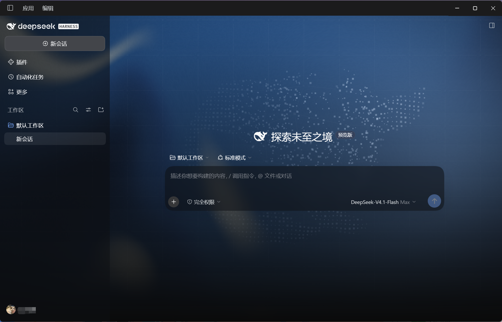
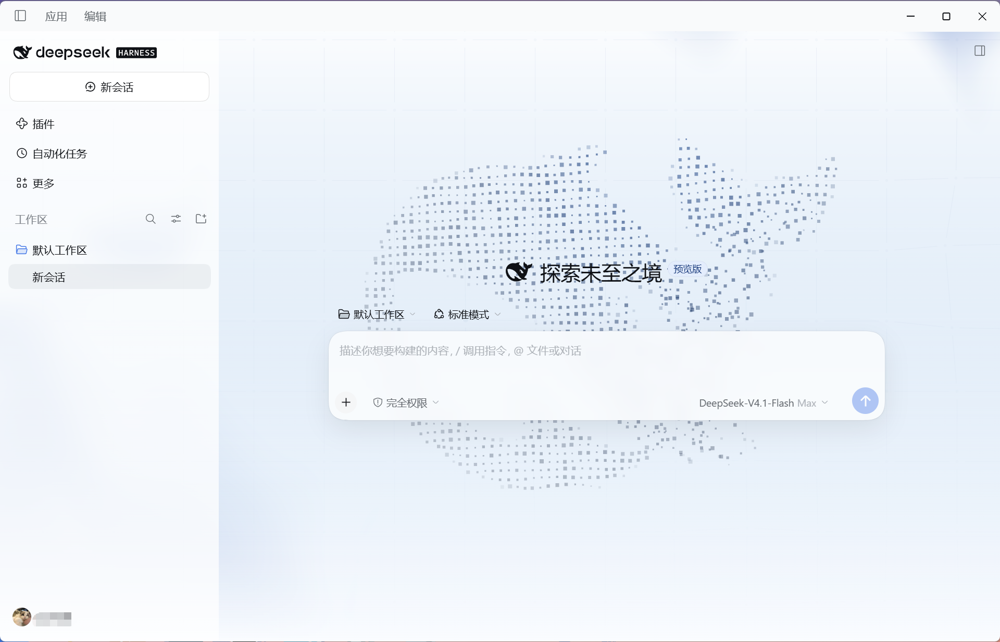

# DeepSeek Harness Website-Inspired Theme v1.0.1

[Changelog](./CHANGELOG.md)

[简体中文](./README.md) | English

A community theme for DeepSeek Harness with animated aurora, an interactive constellation grid, a centered particle whale, and frosted glass surfaces. The theme follows Harness's light and dark appearance settings. All assets are bundled.

## Screenshots

### Dark theme



### Light theme

The light theme builds on the original Web theme by 爱玩蛛的少年.



## Credits and upstream

- **Original Web theme** [爱玩蛛的少年](https://space.bilibili.com/564770445) (Bilibili UID 564770445)
- **Desktop and light-theme adaptation** [我不是Flying (Bilibili)](https://space.bilibili.com/1350238334) / [Flying1303 (GitHub)](https://github.com/Flying1303)
- **Made with** Codex using GPT-6.1 Sol (low reasoning effort).

- Thanks to Bilibili creator [@爱玩蛛的少年](https://space.bilibili.com/564770445) for sharing the original Web theme. [Original demo and download links](https://www.bilibili.com/video/BV1fVbi63ETW/)
- The visual design is inspired by the original official DeepSeek Harness launch page. See the [current official product page](https://www.deepseek.com/harness/) and the [startup guide](https://github.com/deepseek-ai/deepseek-harness#run) for current information.
- This community adaptation adds desktop support, a light theme, and conversation-area centering. The original theme's package manifest declares MIT.

**Choose either installation method.**

## Option 1 — One-click installation on Windows

Use this option with the official Windows desktop client that includes `dsh.cmd`. The ZIP contains the v1.0.1 plugin package and can be used offline after download.

### Installation steps

1. **Initialize Harness**: If this is your first time using DeepSeek Harness, open it, finish the initial setup, and reach the main window to initialize your desktop profile.
2. **Download and extract**: Download the [English ZIP](https://github.com/Flying1303/deepseek-harness-theme/releases/download/v1.0.1/DeepSeek-Harness-Theme-v1.0.1-Windows-Installer-EN.zip) or the [Simplified Chinese ZIP](https://github.com/Flying1303/deepseek-harness-theme/releases/download/v1.0.1/DeepSeek-Harness-Theme-v1.0.1-Windows-Installer-CN.zip) and choose **Extract All**. Keep the included `.cmd` launcher, `install.ps1`, and `deepseek-harness-theme-1.0.1.tgz` in the same folder.
3. **Quit Harness**: If it is running, select **Application → Quit**. If the installer is already waiting for Harness to exit, return to the installer window and press Enter after quitting.
4. **Run the installer**: Double-click `Install-Theme-EN.cmd` for English or `Install-Theme-CN.cmd` for Simplified Chinese in the extracted folder. The tool verifies the bundled package, locates Harness, and installs the plugin into your desktop profile. If prompted for an installation directory, paste the **folder containing `DeepSeek Harness.exe`** and press Enter.
5. **Verify the installation**: After installation succeeds, the tool attempts to open Harness. Open it manually if the window does not appear. Under **Plugins**, confirm that `deepseek-harness-theme` is enabled, then choose **Light**, **Dark**, or **System** under **Settings → General → Appearance**.

### Reinstall or uninstall

- **Replace an existing copy**: Run the tool again to install and enable the bundled v1.0.1 package. It also removes the theme under the legacy `dsh-client-ui-deepseek-bg` identifier.
- **Restore the default appearance**: Disable or uninstall `deepseek-harness-theme` under **Plugins**. If the theme remains visible, quit and reopen Harness.

## Option 2 — Manual installation

### Official desktop client

1. Download [deepseek-harness-theme-1.0.1.tgz](./deepseek-harness-theme-1.0.1.tgz). Keep the archive intact.
2. Open Harness and go to **Plugins → Add plugin**. Paste the absolute path to the downloaded file.
3. Install it and select **Enable now**. If prompted, quit and reopen Harness.
4. Choose **Light**, **Dark**, or **System** under **Settings → General → Appearance**.

If the legacy `dsh-client-ui-deepseek-bg` plugin or an older copy is installed, uninstall it before installing the new one. To restore the default appearance, disable or uninstall `deepseek-harness-theme` and reopen Harness.

### Windows command-line installation

Launch Harness Desktop once to initialize its profile, then quit it completely. Replace both placeholders before running the PowerShell command.

```powershell
& '<DEEPSEEK_HARNESS_INSTALL_DIR>\resources\runtime\cli\bin\dsh.cmd' plugin --profile desktop add '<PLUGIN_ARCHIVE_FULL_PATH>'
```

- Replace `<DEEPSEEK_HARNESS_INSTALL_DIR>` with the folder containing `DeepSeek Harness.exe`. Keep the trailing `\resources\runtime\cli\bin\dsh.cmd`.
- Replace `<PLUGIN_ARCHIVE_FULL_PATH>` with the full path to your downloaded `deepseek-harness-theme-1.0.1.tgz`.
- Remove the angle brackets and keep the single quotes.

Reopen DeepSeek Harness after installation.

### Install on Harness Web

Use **Plugins → Add plugin** with the absolute archive path on the machine running the Web host. You can also install it using the host's CLI.

```sh
dsh plugin --profile web add /absolute/path/deepseek-harness-theme-1.0.1.tgz
```

Restart the Web host and refresh the page.

## Compatibility

Offline installation and removal were verified with the official Windows Desktop 0.2.2-rc.1 CLI. Web, macOS, Linux, and third-party clients require DSH bundle support, Web client plugins, and WebGL2. Those environments have yet to be individually tested. Clients with different layouts may render some glass effects differently.
