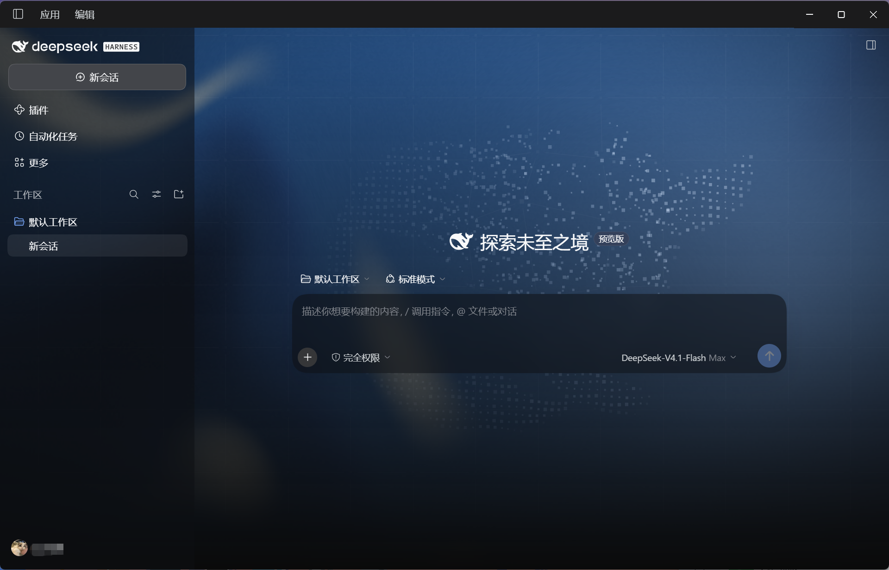
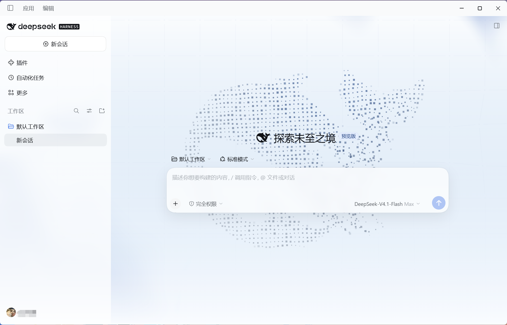

# DeepSeek Harness 官网风格皮肤 v1.0

简体中文 | [English](./README.en.md)

浅色和深色均支持动态流光、星座网格、居中的粒子鲸鱼与磨砂界面。跟随 Harness 的外观设置。插件包无外部依赖，不需要另外下载素材。

v1.0 将画布重建延后到窗口尺寸稳定时，减少拖动窗口时闪烁。

## 效果预览

### 深色主题



### 浅色主题

浅色主题基于「爱玩蛛的少年」分享的原版 Web 皮肤制作。



## 来源与致谢

- **原版 Web 皮肤作者** [爱玩蛛的少年](https://space.bilibili.com/564770445)（B 站 UID 564770445）
- **桌面端与浅色主题适配** [我不是Flying（B 站）](https://space.bilibili.com/1350238334) / [Flying1303 (GitHub)](https://github.com/Flying1303)
- **制作工具与模型** 由 Codex 制作，使用 GPT-6.1 Sol（轻度）。

- 原版 Web 皮肤由 B 站 UP 主 [@爱玩蛛的少年](https://space.bilibili.com/564770445) 分享。感谢原作者！[原版演示与下载入口](https://www.bilibili.com/video/BV1fVbi63ETW/)
- 视觉灵感来自 DeepSeek Harness 的旧版官方发布页。现行[官方产品页](https://www.deepseek.com/harness/)和[启动说明](https://github.com/deepseek-ai/deepseek-harness#run)可供参考。
- 此仓库提供社区适配版，包含桌面端支持、浅色主题、会话区居中和缩放重绘修复。原皮肤包的清单标注 MIT。

**以下两种安装方式任选一种。**

## 方式一：Windows 一键安装

适用于自带 `dsh.cmd` 的 DeepSeek Harness 官方 Windows 桌面端。ZIP 已内置 v1.0 插件包，下载后可以离线安装。

### 安装步骤

1. **首次使用 Harness**：先打开 DeepSeek Harness，完成初次设置并进入主界面，生成桌面端配置。
2. **下载并解压**：[下载 Windows 一键安装 ZIP](https://github.com/Flying1303/deepseek-harness-theme/releases/download/v1.0/DeepSeek-Harness-Theme-v1.0-Windows-Installer.zip)，右键选择「全部解压缩」。保持 `Install-Theme.cmd`、`install.ps1` 和 `dsh-client-ui-deepseek-bg-1.0.0.tgz` 在同一文件夹中。
3. **退出 Harness**：如果应用还在运行，从左上角选择「应用 → 退出」。如果已经打开安装工具并看到退出提示，退出 Harness 后回到安装窗口按 Enter。
4. **运行工具**：在解压后的文件夹里双击 `Install-Theme.cmd`。工具会校验内置插件包、查找 Harness 的安装位置，并将插件安装到当前用户的桌面配置中。如果工具找不到 Harness，按提示粘贴**包含 `DeepSeek Harness.exe` 的文件夹路径**，然后按 Enter。
5. **确认安装**：看到「安装成功」后，工具会尝试打开 Harness。如果窗口没有出现，可以手动打开。进入左侧「插件」，确认 `dsh-client-ui-deepseek-bg` 已启用，然后在「设置 → 通用设置 → 外观」选择浅色、深色或跟随系统。

### 重装与卸载

- **覆盖同名插件**：重新运行工具即可。工具会使用内置的 v1.0 包覆盖安装并启用插件。
- **恢复原版外观**：在左侧「插件」中关闭或卸载 `dsh-client-ui-deepseek-bg`。如果界面仍显示主题，完全退出再重新打开 Harness。

## 方式二：手动安装

### 官方桌面端

1. 将 [dsh-client-ui-deepseek-bg-1.0.0.tgz](./dsh-client-ui-deepseek-bg-1.0.0.tgz) 下载到本地。无需解压。
2. 打开 DeepSeek Harness，进入左侧「插件 → 添加插件」，粘贴该文件的完整路径。
3. 安装后点击「立即启用」。如果界面提示重启，完全退出再打开应用。
4. 进入「设置 → 通用设置 → 外观」，选择浅色、深色或跟随系统。

已装过同名皮肤时，先在插件页卸载旧版，再安装新版。恢复原版时，在插件页关闭或卸载 `dsh-client-ui-deepseek-bg`，然后重新打开客户端。

### Windows 桌面端命令行安装

先启动一次桌面端以初始化配置，随后完全退出。在 PowerShell 中运行下面的命令，先替换两个占位符。

```powershell
& '<DEEPSEEK_HARNESS_INSTALL_DIR>\resources\runtime\cli\bin\dsh.cmd' plugin --profile desktop add '<PLUGIN_ARCHIVE_FULL_PATH>'
```

- `<DEEPSEEK_HARNESS_INSTALL_DIR>` 替换为包含 `DeepSeek Harness.exe` 的安装目录，保留其后的 `\resources\runtime\cli\bin\dsh.cmd`。
- `<PLUGIN_ARCHIVE_FULL_PATH>` 替换为下载的 `dsh-client-ui-deepseek-bg-1.0.0.tgz` 的完整文件路径。
- 替换时去掉尖括号，保留两边的单引号。

安装完成后重新打开 DeepSeek Harness。命令行用的是桌面安装目录自带的 dsh。

### Harness Web

在有 Web 插件管理器的版本上，可使用相同的本地包路径安装并启用。若 Web Host 部署在另一台机器上，路径必须在 Host 那台机器上可访问。也可在 Host 上使用该 Web 安装的 CLI：

```sh
dsh plugin --profile web add /absolute/path/dsh-client-ui-deepseek-bg-1.0.0.tgz
```

重启 Web Host 并刷新页面。

## 兼容范围

Windows 官方桌面版 0.2.2-rc.1 已用于开发和安装验证。同系列 Web、macOS 或 Linux 客户端需支持 DSH bundle、Web 客户端插件和 WebGL2。其他版本和第三方客户端需实测，布局改动较大的版本可能缺少部分磨砂效果。仅支持 DeepSeek Harness 的插件系统。
